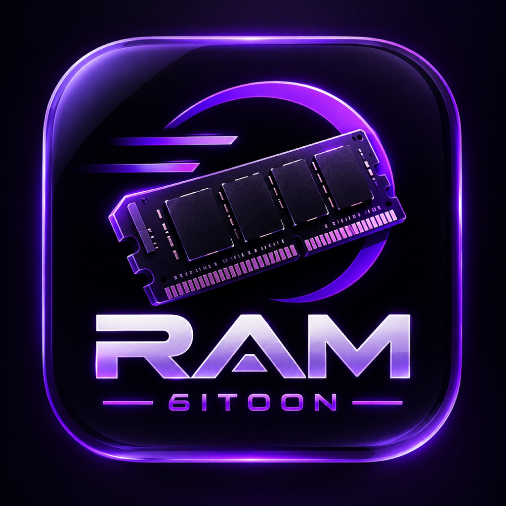

# ram 6itoon

<p align="center">
  
</p>

<p align="center">
  <b>Increased Memory Limit</b> for sideloaded iOS apps — without Xcode<br>
  فعال‌سازی محدودیت حافظه بیشتر برای اپ‌های سایدلود شده، بدون نیاز به Xcode
</p>

<p align="center">
  <a href="https://github.com/6itoon/ram-6itoon/releases"></a>
  <a href="https://github.com/6itoon/ram-6itoon/actions"></a>
  
  
</p>

---

## What is this?

**ram 6itoon** is a lightweight on-device tool (based on [GetMoreRam](https://github.com/hugeBlack/GetMoreRam) + [StosSign](https://github.com/stossy11/StosSign)) that enables the **Increased Memory Limit** entitlement on your sideloaded apps.

You sign in with the same Apple ID used to sideload the target app, refresh App IDs, enable the entitlement, then reinstall the app from SideStore / AltStore / iloader.

---

## Features

| Feature | Description |
|--------|-------------|
| **No Xcode** | Works entirely on-device |
| **-80045 / 503 fix** | Default Windows Anisette servers (`ani.jkcoxson.com`, `ani2.stikstore.app`) + client-info from server |
| **Anisette picker** | Preset servers + custom URL (like SideStore) |
| **Persian (فارسی)** | Full UI localization |
| **SideStore import** | Import exported SideStore account JSON |
| **Modern UI** | Clean dark theme inspired by SideInstaller |

---

## Install

1. Download the latest **IPA** from [Releases](https://github.com/6itoon/ram-6itoon/releases)
2. Sideload with **SideStore**, **AltStore**, **iloader**, or **SideInstaller**
3. Open the app

Or build from source — GitHub Actions produces a fakesigned IPA on every push to `main`.

---

## How to use

1. Open **Settings** → **Sign in** with the Apple ID you used to sign the target app  
   *(or Import SideStore Account if you already exported it)*
2. Go to **App IDs** → **Refresh**
3. Tap the app you want
4. Tap **Add Increased Memory Limit**
5. Reinstall that app from SideStore / AltStore
6. Done — check that Increased Memory Limit is enabled

---

## If login fails

Apple tightened GrandSlam auth (Oct 2026). Try this order:

1. Set Anisette server to **jkcoxson (Windows ADI)** → `https://ani.jkcoxson.com`  
   or **StikStore (Windows ADI)** → `https://ani2.stikstore.app`
2. Tap **Clean Up Keychain**
3. Force-quit the app completely, reopen, sign in **once**
4. Accept any new agreements at [developer.apple.com/account](https://developer.apple.com/account)
5. Prefer **Import SideStore Account** if SideStore is already signed in
6. Avoid spamming login — rate limits cause more failures

---

## Anisette servers (recommended)

| Name | URL |
|------|-----|
| jkcoxson (Windows ADI) | `https://ani.jkcoxson.com` |
| StikStore (Windows ADI) | `https://ani2.stikstore.app` |
| jkcoxson (Mac ADI) | `https://mac-ani.jkcoxson.com` |

Avoid legacy `ani.sidestore.io` as default when it returns blocked client-info.

---

## Build

```bash
git clone https://github.com/6itoon/ram-6itoon.git
cd ram-6itoon
git submodule update --init --recursive
open GetMoreRam.xcodeproj
```

Or push to `main` / run the **Xcode - Build** workflow — IPA appears under Actions artifacts and Nightly Release.

---

## Language

- **English**
- **Persian (فارسی)** — follows system language

---

## Credits

- [Stossy11](https://github.com/stossy11) — StosSign  
- [hugeBlack](https://github.com/hugeBlack/GetMoreRam) — original GetMoreRam  
- [SideStore](https://github.com/SideStore) — Anisette approach  
- [nab138 / iloader](https://github.com/nab138/iloader) — Windows Anisette server approach for -80045 / 503  
- [FrizzleM / SideInstaller](https://github.com/FrizzleM/SideInstaller) — UI inspiration  
- **6itoon** — this fork (ram 6itoon)

---

## Disclaimer

For personal / educational use with your own Apple ID and apps. You are responsible for complying with Apple’s terms and local law.

---

<p align="center">
  made with care · ram 6itoon
</p>
